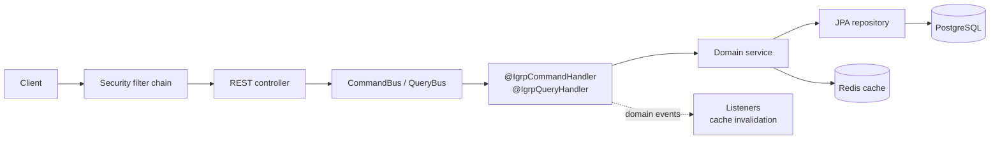
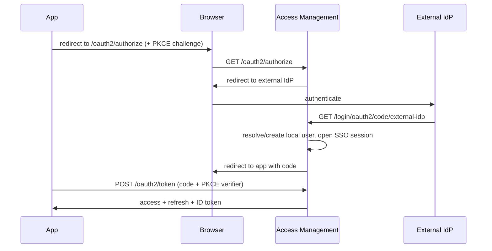

# iGRP Access Management API — Comprehensive Documentation

Identity and access management for the iGRP 3.0 platform. This service is both an
**OAuth 2.1 / OpenID Connect authorization server** — it issues the platform's own
access, refresh and ID tokens — and the **system of record** for users, roles,
permissions, departments, applications and sessions.

**Stack:** Java 26 · Spring Boot 3.5.14 · Spring Authorization Server · Spring Cloud 2025.0.0 · PostgreSQL · Redis · MinIO/S3

---

## Table of Contents

- [Overview](#overview)
- [Architecture](#architecture)
- [Getting Started](#getting-started)
- [Configuration](#configuration)
- [Authentication](#authentication)
- [API Reference](#api-reference)
- [Session Management](#session-management)
- [Error Responses](#error-responses)
- [Client SDKs](#client-sdks)
- [Development](#development)
- [Deployment](#deployment)
- [Observability](#observability)
- [Security](#security)
- [Documentation Index](#documentation-index)
- [Contributing](#contributing)
- [Support and License](#support-and-license)

---

## Overview

### What this service does

| Capability | Summary |
|---|---|
| **Authorization server** | Issues platform JWTs via authorization-code (with PKCE), refresh-token and client-credentials grants. Supports RFC 7009 revocation and RP-initiated logout. |
| **Federated login** | Delegates end-user authentication to an external OIDC provider (Keycloak, WSO2 Identity Server), then issues its own tokens. |
| **Authorization model** | Users hold roles; roles hold permissions; both can be department-scoped. Role assignments may be temporary with automatic expiry. |
| **Permission checks** | Real-time checks over a Redis-cached read path that degrades to direct JDBC when Redis is unavailable. |
| **Session management** | A server-side session per application sign-in, with idle and absolute timeouts, a per-user cap, revocation and logout cascade. |
| **Applications and menus** | Registration of platform applications with their resources and role-filtered menus. |
| **M2M synchronisation** | Idempotent push of applications, permissions and menus from other services, deduplicated by SHA-256 structural hashing. |
| **Security audit** | An append-only, hash-chained log of security-semantic events, with reporting and archival endpoints. |

### What it deliberately does not do

The service **never mutates the external identity provider.** It does not create users
in Keycloak, call admin APIs or synchronise state outward. Its only interaction with the
IdP is authentication-time validation: issuer discovery, JWT verification and claims
extraction.

This is enforced, not merely documented — `NoAdapterArchitectureTest` fails the build if
any class depends on an `IAdapter` type or on a Keycloak admin API. Background:
[`docs/NO_ADAPTER_ARCHITECTURE.md`](docs/NO_ADAPTER_ARCHITECTURE.md).

---

## Architecture

### Request flow



Controllers do no business logic; they dispatch a command or query onto the bus, which
routes it to the handler annotated for it. Handlers publish domain events
(`UserRoleChangedEvent`, `RolePermissionChangedEvent`) that listeners consume to
invalidate caches.

### Two security filter chains

Which chain serves a request determines almost everything about how it behaves.

| | Authorization-server chain | Resource-server chain |
|---|---|---|
| **Serves** | `/oauth2/**`, `/connect/**`, `/userinfo`, `/login/**` | `/api/**` |
| **Authenticates with** | Browser session (federated login) | `Bearer` JWT |
| **Session policy** | `IF_REQUIRED` | **`STATELESS`** |
| **Configured in** | `AuthorizationServerConfig` | `OAuth2SecurityConfiguration` |

The API chain being stateless is load-bearing: it means API traffic creates no servlet
session at all, which is why the shared session store (below) carries only login traffic.
`ResourceServerChainStatelessTest` guards it.

### Bounded contexts

Each top-level package under `cv.igrp.platform.access_management` is a bounded context
with the same internal shape:

```
<context>/
├── application/
│   ├── commands/    # write operations
│   └── queries/     # read operations
├── domain/service/  # business logic
├── interfaces/rest/ # controllers
├── infrastructure/  # persistence, schedulers, caches
└── mapper/          # entity ↔ DTO
```

`app` · `authorization` · `department` · `files` · `global_configuration` · `m2m` ·
`notification` · `oauth_server` · `role` · `security_audit` · `session` · `users` ·
`shared`

Entities live under `shared/infrastructure/persistence/entity/`, extend `AuditEntity`
and are audited by Hibernate Envers.

---

## Getting Started

### Prerequisites

| | Version | Notes |
|---|---|---|
| JDK | **26** | `<java.version>26</java.version>`. Lombok must match the JDK — see [Troubleshooting](#troubleshooting). |
| Maven | 3.9+ | |
| PostgreSQL | 14+ | |
| Redis | 6+ | Required at startup, not optional |
| OIDC provider | Keycloak 26+ or WSO2 IS | For end-user authentication |
| MinIO or S3 | — | Only if file storage is used |
| Docker | — | Optional, for the container build |

### 1. Configure

```bash
cp .env.example .env
```

Then set, at minimum, the variables in [Required configuration](#required-configuration).
`application.properties` imports `.env` automatically via
`spring.config.import=optional:file:.env[.properties]`.

### 2. Seed the identity provider

For a local Keycloak, import the bundled realm:

```bash
# Place docs/igrp-realm.json in Keycloak's import directory, then:
/opt/keycloak/bin/kc.sh start-dev --import-realm
```

The realm file ships with **placeholder client secrets** (`CHANGEME-NOT-A-REAL-SECRET`).
It will import, but no client authenticates until you set real values in the Keycloak
console. Never commit a working secret back into that file. Full walkthrough:
[`docs/IMPORT_REALM_GUIDE.md`](docs/IMPORT_REALM_GUIDE.md).

### 3. Run

```bash
mvn spring-boot:run -Dspring-boot.run.profiles=development
```

The `development` profile enables `spring.jpa.hibernate.ddl-auto=update` and SQL logging.
`staging` and `production` use `ddl-auto=validate`.

### 4. Verify

```bash
curl http://localhost:8080/actuator/health
curl http://localhost:8080/.well-known/openid-configuration
```

Then open Swagger UI at <http://localhost:8080/swagger-ui.html>.

---

## Configuration

Configuration is entirely environment-driven. [`.env.example`](.env.example) is the
complete, commented reference — roughly 130 variables. The tables below cover what you
cannot start without and what you will most often change.

### Required configuration

The application fails at startup without these.

| Variable | Purpose |
|---|---|
| `AUTH_JWT_ISSUER` | Issuer URI whose JWKS validates incoming JWTs |
| `IGRP_OAUTH_ISSUER` | Issuer this service stamps on the tokens it mints |
| `REDIS_HOST` | Redis host |
| `IGRP_SUPERADMIN_USER_EXTERNAL_ID` | External subject seeded as the first superadmin |
| `IGRP_APP_CENTER_URL` | Application Center base URL |
| `IGRP_OAUTH_EXTERNAL_IDP_ISSUER_URI` | External OIDC provider issuer |
| `IGRP_OAUTH_EXTERNAL_IDP_CLIENT_ID` / `_SECRET` | This service's client registration at that provider |

### Database

Either supply a full JDBC URL, or let it be composed from parts:

```properties
DATABASE_URL=jdbc:postgresql://localhost:5432/db_igrp_iam   # takes precedence
# or
POSTGRES_HOST=localhost
POSTGRES_PORT=5432
POSTGRES_DATABASE=db_igrp_iam
POSTGRES_USER=postgres
POSTGRES_PASSWORD=...
```

### Session configuration

Two independent mechanisms. See [Session Management](#session-management) for why they
are different things.

| Variable | Default | Governs |
|---|---|---|
| `IGRP_SESSION_TIMEOUT_SECONDS` | `1800` | Idle timeout of an application session |
| `IGRP_SESSION_ABSOLUTE_TIMEOUT_SECONDS` | `28800` | Hard ceiling on an application session |
| `IGRP_SESSION_MAX_PER_USER` | `5` | Concurrent active sessions per user, LRU-evicted beyond |
| `IGRP_SESSION_REFRESH_GRACE_SECONDS` | `300` | Added to access-token TTL when sliding the idle deadline |
| `IGRP_SESSION_ENFORCEMENT_ENABLED` | `true` | Kill switch for `SessionEnforcementFilter` |
| `IGRP_SSO_SESSION_TIMEOUT_SECONDS` | `28800` | Idle timeout of the **browser SSO session** |

> `IGRP_SESSION_MAX_PER_USER` must be at least *(applications per host × devices per
> user)*. Every application sign-in costs one session against the cap, and the oldest is
> evicted when it is exceeded.

### Other groups

`IGRP_OAUTH_*` (keys, default client, external IdP, login policy) ·
`IGRP_STORAGE_*` (MinIO/S3) · `IGRP_NOTIFICATION_SERVICE_*` and `SMTP_*` ·
`AUDIT_CHAIN_*` · `OTEL_*` · `MANAGEMENT_*` · `ENABLE_SWAGGER` ·
`IGRP_CORS_ALLOWED_ORIGINS` (a literal `*` is rejected when credentials are allowed).

---

## Authentication

This service **issues** the platform's tokens. Applications integrate with it, not with
the upstream IdP directly.

### Endpoints

All paths are Spring Authorization Server defaults — only the issuer is customised.

| Endpoint | Purpose |
|---|---|
| `GET /.well-known/openid-configuration` | Discovery; start here |
| `GET /oauth2/authorize` | Authorization endpoint (PKCE) |
| `POST /oauth2/token` | Token endpoint |
| `POST /oauth2/revoke` | Revocation (RFC 7009) |
| `POST /oauth2/introspect` | Introspection |
| `GET /oauth2/jwks` | Signing keys; supports a secondary key for rotation |
| `GET /userinfo` | UserInfo |
| `GET|POST /connect/logout` | RP-initiated logout |

### Authorization code with PKCE

The flow for interactive applications. The user is redirected to the external IdP; on
return, this service issues **its own** tokens.



Token issuance also opens a server-side session row and stamps `sid` and `device_id`
claims onto the access token.

### Client credentials (machine-to-machine)

```bash
curl -X POST http://localhost:8080/oauth2/token \
  -u "<client-id>:<client-secret>" \
  -d "grant_type=client_credentials&scope=<scope>"
```

M2M tokens carry no `sid`. Both `M2MTokenRejectionFilter` and `SessionEnforcementFilter`
skip the `/api/m2m/` prefix so these tokens are admitted there and rejected elsewhere.

### Calling the API

```bash
curl http://localhost:8080/api/users \
  -H "Authorization: Bearer <access-token>"
```

### Authorization on endpoints

Endpoints are guarded by `@PreAuthorize` against generated permission constants:

```java
@PreAuthorize("@igrpAuthorization.checkPermission(T(Permission).IGRP_APPLICATIONS_CREATE)")
```

Permissions are declared with `@IgrpPermission`, code-generated into a registry, and
synchronised into the database at startup. Authorities are stored as plain role codes —
there is no `ROLE_` prefix convention. Any user holding `SUPER_ADMIN_ROLE` bypasses
permission checks entirely.

Login-time policy can additionally require a verified email
(`IGRP_OAUTH_REQUIRE_EMAIL_VERIFIED`), an allowed email domain
(`IGRP_OAUTH_ALLOWED_EMAIL_DOMAINS`) or specific ACR values
(`IGRP_OAUTH_REQUIRED_ACR_VALUES`). A disabled account is refused with the OAuth error
code `account_disabled`.

---

## API Reference

**The generated OpenAPI specification is authoritative.** It is produced from the code
and cannot drift from it.

| | |
|---|---|
| Swagger UI | `/swagger-ui.html` |
| OpenAPI JSON | `/v3/api-docs` |
| Toggle | `ENABLE_SWAGGER` (default `true`; disable in production) |
| Postman collection | [`docs/iGRP 3.0 - Access Management API.postman_collection.json`](docs/) |
| Hand-written catalogue | [`docs/API_REFERENCE.md`](docs/API_REFERENCE.md) — worked request/response examples |

### Endpoint groups

| Area | Base path |
|---|---|
| Applications | `/api/applications` |
| Users | `/api/users` |
| Roles | `/api/roles` |
| Departments | `/api/departments` |
| Permission checks | `/api/authorize/check` |
| Files | `/api/files` |
| Global configuration | `/api/global-configuration` |
| OAuth clients | `/api/clients` |
| Service accounts | `/api/service-accounts` |
| Sessions (caller's own) | `/api/session` |
| Sessions (administrative) | `/api/admin/sessions`, `/api/admin/users` |
| Audit log | `/api/auth/audit` |
| Audit reports and archive | `/api/auth/reports` |
| M2M synchronisation | `/api/m2m` |

---

## Session Management

Two mechanisms share the word "session" and are routinely confused. They have different
tables, lifetimes and owners.

### 1. `SPRING_SESSION` — the browser SSO session

The servlet session created by the browser login flow. Holds the pending OAuth2
authorization request (including its PKCE verifier), the `SecurityContext` and the saved
request.

Stored in **PostgreSQL** via `spring-session-jdbc` so that a login survives landing on a
different replica. Without a shared store, a browser that starts at `/oauth2/authorize`
on one pod and returns to the IdP callback on another finds no saved request matching its
`state`, and the user sees *"Login could not be completed"*
(`authorization_request_not_found`). A rolling deploy reproduces this even on a single
replica.

PostgreSQL rather than Redis deliberately: it is already a hard dependency of login, so
the session store adds no new failure mode, whereas Redis currently backs only caches and
degrades gracefully. Full reasoning:
[`plans/shared-servlet-session/scope.md`](plans/shared-servlet-session/scope.md).

Attributes are stored as JSON through `SecurityStoreObjectMapperFactory`. **Anything
added to this session must be on that allowlist**, or it fails to deserialise during a
login. Lifetime: `IGRP_SSO_SESSION_TIMEOUT_SECONDS`. Pruned by
`spring.session.jdbc.cleanup-cron`.

### 2. `t_user_session` — application sessions

One row per application sign-in, carrying the `sid` claim stamped on that application's
access token. Sliding idle timeout, absolute ceiling, per-user cap with LRU eviction.
Pruned by `SessionCleanupScheduler`.

`SessionEnforcementFilter` checks the `sid` on every API request and answers
`401 session_revoked` when the row is no longer active. `/api/session/check` is
**exempt** from that filter, so a client holding a revoked token can ask why instead of
receiving an opaque 401:

```bash
curl /api/session/check -H "Authorization: Bearer <token>"
# → 200 {"valid": false, "reason": "USER_LOGOUT"}
```

Reasons include `USER_LOGOUT`, `IDLE_TIMEOUT`, `ABSOLUTE_TIMEOUT`, `USER_CLOSED`,
`SESSION_LIMIT_EXCEEDED` and `SESSION_NOT_FOUND`. Clients should distinguish
`USER_LOGOUT` (sign out) from `SESSION_LIMIT_EXCEEDED` (cap eviction — not a sign-out).

### Logout cascade

Several iGRP applications typically run on one host, each with its own session row, the
later ones signing in silently via `prompt=none`. RP-initiated logout revokes **all
sessions opened under the same AM sign-in**, not only the application that logged out.

The link is a per-sign-in login id carried on the authentication principal, stored as a
SHA-256 digest in `t_user_session.sso_session_key`. Rows without a key — client-credentials
grants, and rows created before the column existed — are revoked alone.

> **Caveat when testing.** If an application runs on a different site from this service
> (for example `localhost` against a remote deployment), `/connect/logout` is a cross-site
> POST and the `SameSite=Lax` session cookie is not sent. The sign-in cannot be resolved,
> so **nothing cascades and the servlet session survives**. Test the cascade same-site.

Specification: [`plans/sso-session-logout-cascade/requirements.md`](plans/sso-session-logout-cascade/requirements.md).

---

## Error Responses

All errors use RFC 7807 `application/problem+json`, produced by
`GlobalExceptionHandler`:

```json
{
  "type": "about:blank",
  "title": "Not Found",
  "status": 404,
  "detail": "Application not found for code: FOO",
  "instance": "/api/applications/FOO",
  "errorCode": "IGRP_AUTH_APPLICATION_NOT_FOUND_BY_CODE"
}
```

OAuth2 endpoints instead return the error format their specifications require — for
example `{"error": "invalid_grant", "error_description": "session_not_active"}`.

Internally, exceptions are raised through `IgrpResponseStatusException.of()`,
`.notFound()` and `.badRequest()`.

---

## Client SDKs

Prefer a generated client over hand-rolled HTTP.

| Language | Package | Source |
|---|---|---|
| TypeScript | `@igrp/platform-access-management-client-ts` | `access-management/frontend/packages` |
| Java | iGRP auth backend monorepo | `access-management/backend/modules` |

Both are published to the internal Nexus at `sonatype.nosi.cv`.

---

## Development

### Commands

```bash
mvn -B -DskipTests clean package          # build
mvn test                                  # full suite
mvn test -Dtest=SsoSessionKeyTest          # one class
mvn dependency-check:check                 # OWASP dependency scan
docker build -t access-management-api .    # container image
```

### Testing

The suite is **999 tests** and must stay green. It is unit-level and mock-based: it does
not start an application context, so bean-wiring and context-start failures are **not**
caught by it — verify those against a running instance.

Notable guard tests, which exist because the thing they assert has broken before:

| Test | Asserts |
|---|---|
| `NoAdapterArchitectureTest` | No class touches `IAdapter` or Keycloak admin APIs |
| `ResourceServerChainStatelessTest` | The API chain stays `STATELESS` |
| `SessionStoreConversionTest` | Session attributes round-trip through the JSON allowlist |
| `SessionRepositoryBeanNameTest` | The session repository bean does not collide with Spring Session's |
| `IgrpOidcUserSerializationTest` | The SSO login id survives serialisation |

Guide: [`docs/TESTING.md`](docs/TESTING.md).

### Database migrations

There is no Flyway. Custom DDL belongs in `DatabaseMigrationRunner.run()`
(`shared/config/`), written idempotently (`IF NOT EXISTS`, `ADD COLUMN IF NOT EXISTS`) so
it is a no-op on every boot after the first. In `development`, Hibernate's
`ddl-auto=update` creates entity tables; `staging` and `production` use `validate`, so
anything Hibernate will not generate must be in the runner.

### Troubleshooting

| Symptom | Cause |
|---|---|
| `ExceptionInInitializerError: com.sun.tools.javac.tree.EndPosTable` at build | Lombok predates the JDK. Lombok patches javac internals, so it must be new enough for the compiler in use. Pin the toolchain rather than floating it. |
| `authorization_request_not_found` at login | The shared servlet session store is not active, or `SPRING_SESSION` tables are missing. |
| `... is not in the allowlist` during login | A type reachable from a session or authorization attribute is missing from `SecurityStoreObjectMapperFactory`. |
| `401` with `session_revoked` on every API call | The caller's `t_user_session` row is not `ACTIVE`. Ask `/api/session/check` for the reason. |

---

## Deployment

`.gitlab-ci.yml` builds multi-architecture (ARM64 + AMD64) images for both JVM and
GraalVM native targets.

| | |
|---|---|
| Registry | `registry.nosi.cv/igrp/access-management-api` |
| JVM image | `Dockerfile` — Temurin 26 build, Temurin 26 JRE runtime, exposes `8080` |
| Native image | `Dockerfile_native` |
| Pre-release testing | the `deploy/pre-release` branch |

Base images are **pinned to explicit versions on purpose.** A floating tag previously
rolled forward to a newer JDK than Lombok supported and broke the pipeline.

### Deployment notes

- Set `ENABLE_SWAGGER=false` outside development.
- `staging` and `production` publish only the `health` actuator endpoint, hide details and
  cap access at read-only via `MANAGEMENT_*`.
- Deploying the shared servlet session store for the first time **signs every active user
  out once** — in-memory sessions cannot be migrated. Schedule it and note it in the
  release notes.

---

## Observability

| | |
|---|---|
| Health | `/actuator/health`, plus liveness and readiness groups — the only public actuator paths |
| Metrics | Micrometer; session metrics include creation, LRU eviction and refresh rejections |
| Tracing and logs | OpenTelemetry via `OTEL_*`; collector at `OTEL_COLLECTOR_ENDPOINT` |
| Audit trail | Hibernate Envers for entity history, plus `SecurityAuditLogEntity` for security events |

The security audit log is hash-chained (`AUDIT_CHAIN_SECRET`) so tampering is detectable;
`POST /api/auth/audit/validate` verifies the chain. Duplicate login events are suppressed by a
one-hour cache keyed on the JWT id.

---

## Security

- **OWASP ASVS mapping:** [`docs/ASVS-MAPPING.md`](docs/ASVS-MAPPING.md)
- **Dependency scanning:** `mvn dependency-check:check`
- **Session cookies:** `SameSite=Lax`, `Secure`, `HttpOnly`
- **Key rotation:** a secondary signing key can be published through the JWKS endpoint
  (`IGRP_OAUTH_SECONDARY_*`) so verifiers pick up the new key before the old one is retired
- **Refresh-token reuse** is detected; a replayed token revokes the session
- **CORS:** `IGRP_CORS_ALLOWED_ORIGINS` must list explicit origins — a wildcard is
  rejected when credentials are permitted

**Never commit secrets.** `docs/igrp-realm.json` is a non-production seed whose client
secrets are placeholders; treat a realm export as a template, never as a way to move
production credentials between environments.

---

## Documentation Index

### Integration

| Document | Contents |
|---|---|
| [`docs/API_REFERENCE.md`](docs/API_REFERENCE.md) | Endpoint catalogue with worked examples |
| [`docs/CLAIMS_MAPPING.md`](docs/CLAIMS_MAPPING.md) | External IdP claims → platform claims |
| [`docs/IGRP_PERMISSIONS_SYNC_NEXTJS_GUIDE.md`](docs/IGRP_PERMISSIONS_SYNC_NEXTJS_GUIDE.md) | Permission sync from a Next.js application |
| [`docs/AUDIT_REPORTS_INTEGRATION_GUIDE.md`](docs/AUDIT_REPORTS_INTEGRATION_GUIDE.md) | Audit report endpoints |
| [`docs/SESSION_FETCHING.md`](docs/SESSION_FETCHING.md) | Session read paths |
| [`docs/I18N.md`](docs/I18N.md) | Locale resolution, message bundles, `PUT /api/users/me/locale` |

### Setup and operations

| Document | Contents |
|---|---|
| [`docs/IMPORT_REALM_GUIDE.md`](docs/IMPORT_REALM_GUIDE.md) | Importing the Keycloak realm |
| [`docs/OIDC_WSO2.md`](docs/OIDC_WSO2.md) | WSO2 Identity Server specifics |
| [`docs/IAM_SYNCHRONIZATION.md`](docs/IAM_SYNCHRONIZATION.md) | Synchronisation boundaries |
| [`docs/TESTING.md`](docs/TESTING.md) | Test strategy |

### Architecture and design

| Document | Contents |
|---|---|
| [`docs/ADR-001.md`](docs/ADR-001.md) | Architecture decision record |
| [`docs/NO_ADAPTER_ARCHITECTURE.md`](docs/NO_ADAPTER_ARCHITECTURE.md) | Why no IAM provider mutation |
| [`docs/PERMISSION_MANAGEMENT_SPECS.md`](docs/PERMISSION_MANAGEMENT_SPECS.md) | Permission model |
| [`docs/ASVS-MAPPING.md`](docs/ASVS-MAPPING.md) | OWASP ASVS coverage |
| [`docs/ENTERPRISE_IAM_RECOMMENDATIONS.md`](docs/ENTERPRISE_IAM_RECOMMENDATIONS.md) | Hardening recommendations |
| [`plans/shared-servlet-session/scope.md`](plans/shared-servlet-session/scope.md) | Shared session store design |
| [`plans/sso-session-logout-cascade/requirements.md`](plans/sso-session-logout-cascade/requirements.md) | Logout cascade requirements |

---

## Contributing

### Branching

**`development` is the integration branch.** Branch from it and push back to it unless a
request names another branch explicitly.

`staging` and `production` are promotion targets, and `deploy/*` branches are release
targets driven by CI. Never push to them as ordinary work. `main` and
`version/0.2.0-beta` no longer exist.

### Before opening a merge request

1. `mvn test` — the full suite must pass.
2. Add a guard test for anything that could regress silently, especially configuration and
   wiring.
3. Update this README and the relevant `docs/` page in the same change.
4. Write idempotent DDL in `DatabaseMigrationRunner`, never a bare `ALTER`.
5. Keep `.env.example` in step with any new configuration variable.

---

## Support and License

| | |
|---|---|
| Repository | `git.nosi.cv/igrp-3_0/igrp-auth/backend/igrp-platform-access-management` |
| Maintainer | iGRP Platform Team, NOSI |

No `LICENSE` file is present in this repository. Treat the code as internal to the iGRP
platform unless the platform team states otherwise.
